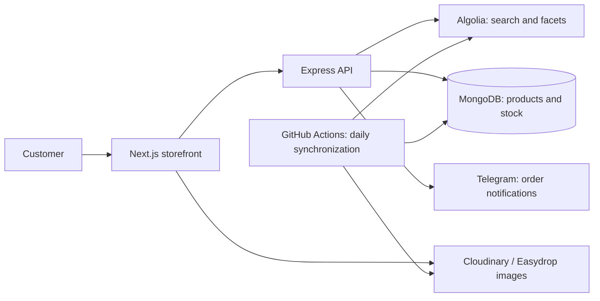

# Krossava — Sneaker Storefront

A Ukrainian-language e-commerce storefront built with **Next.js 16, React 19 and TypeScript**. Customers can browse seasonal collections, narrow results by brand, model and available size, explore product galleries and submit orders through a Telegram-connected checkout.

The full-stack project also handles the operational side of a store: supplier stock synchronization, SKU-based photo matching, search indexing and cleanup of assets belonging to sold-out products.

[Store website](https://krossava.com.ua) · [Backend repository](https://github.com/RavemanThc/krossava-store-server) · [Author: Vlad Harkusha](https://github.com/RavemanThc)

> This README describes the repository implementation. The deployed website may lag behind the latest local changes.

## Project at a glance

| Area | Implementation |
| --- | --- |
| Storefront | Next.js App Router, Server Components and interactive React components |
| Catalog discovery | Algolia search, dependent facets and URL-based pagination |
| Product pages | Readable URLs with stable IDs, image gallery and available sizes |
| Shopping flow | Persistent cart, quantity limits, validated checkout and Telegram delivery |
| Data pipeline | Easydrop → MongoDB → Algolia; Telegram comment photos → Cloudinary |
| Discoverability | Dynamic metadata, canonical URLs, structured data and cursor-backed sitemap |
| Quality | TypeScript, ESLint, Node test runner and integration-focused backend tests |

## Customer experience

- Browse brand categories, seasonal collections, sale items and large sizes.
- Search the catalog and share URLs that retain the selected filters and page.
- In a **brand category**, select a model and size without choosing the brand twice.
- In a **seasonal or sale category**, select a brand, then a model and size. Counts and options reflect the active filters and stock.
- View the supplier's main image alongside additional photos in a swipeable product gallery.
- Keep a cart between visits, adjust quantities within available stock and revisit recently viewed products.
- Submit a validated order for delivery to the store's Telegram chat.
- Use a chat-style catalog search with links to matching products.

The current chat implementation searches Algolia. It does not use an LLM, Redis-backed conversation memory or an n8n agent.

## Engineering decisions

### One route family for catalog and product pages

[`app/sneakers/[[...slug]]/page.tsx`](app/sneakers/[[...slug]]/page.tsx) resolves the catalog root, category pages and product URLs. Product links combine a readable name with a stable database ID; route helpers handle Unicode category names and canonical redirects.

Examples:

```text
/sneakers
/sneakers/nike
/sneakers/new-balance?model=9060&size=42
/sneakers/термо?brand=New+Balance&model=9060
/sneakers/<product-name>-<product-id>
```

Changing a brand clears the previous model and page. Changing a model or size resets pagination while preserving other filters. Direct links and browser navigation therefore reproduce the same selection.

### Search facets come from the catalog

The API returns available brands, models and sizes with counts. The frontend renders those results instead of maintaining a separate hard-coded model list. Unknown model names remain accessible through the broader brand and size filters.

Brand pages include that brand's products across supplier collections. A seasonal page retains its category constraint when a customer adds a brand filter.

### Server rendering with focused client-side state

Catalog and product data are loaded on the server. Client components handle filters, the gallery, cart and checkout interactions. Category lookups are shared and cached for five minutes; the category cache does not store prices or stock.

Turbopack development output uses `.next-turbo`, separately from the production `.next` directory. Remote image sources are explicitly configured for Easydrop and Cloudinary.

### SEO is part of routing and data access

- Product and category metadata, Open Graph information and canonical URLs.
- Product, offer, breadcrumb, organization and store structured data.
- Search and additional filter combinations marked `noindex` to limit duplicate indexed pages.
- A dynamic sitemap that reads products through a MongoDB cursor endpoint, independently of Algolia's searchable-page limit.
- Supplier HTML descriptions sanitized before rendering.

These are implementation choices, not a claim of measured ranking gains or a guaranteed Lighthouse score.

## Architecture



The frontend never needs MongoDB credentials, an Algolia administration key, Cloudinary secrets or a Telegram session. Integrations that require those credentials run in the backend or synchronization workflow.

## Stack

| Responsibility | Tools |
| --- | --- |
| Rendering and routing | Next.js 16, React 19, TypeScript |
| HTTP and server-state tooling | Axios, TanStack Query |
| Persistent client state | Zustand |
| Forms and validation | Formik, Yup |
| Styling and interaction | CSS Modules, Swiper, GSAP, React Icons |
| Content handling | sanitize-html |
| Development and checks | Turbopack, ESLint, TypeScript, Node test runner |

## Run locally

Use **Node.js 22 or newer** and npm. A configured backend with MongoDB and Algolia is required to browse a populated catalog; this repository does not include a mock catalog.

```bash
git clone https://github.com/RavemanThc/krossava-store-front.git
cd krossava-store-front
npm ci
```

Create `.env.local` in the project root:

```dotenv
NEXT_PUBLIC_API_URL=http://localhost:3100
# Optional: your Google Analytics measurement ID
NEXT_PUBLIC_GA_ID=
```

Start the backend on port `3100` using its [setup guide](https://github.com/RavemanThc/krossava-store-server#run-locally), then start the storefront:

```bash
npm run dev
```

Open [localhost:3000](http://localhost:3000). To choose another frontend port, use `npm run dev -- --port 3102`.

`NEXT_PUBLIC_*` values are public browser configuration. Never place server credentials in them.

## Commands and verification

| Command | Purpose |
| --- | --- |
| `npm run dev` | Start the Turbopack development server |
| `npm run build` | Create a production build |
| `npm start` | Serve the production build |
| `npm test` | Run regression tests |
| `npx tsc --noEmit` | Check TypeScript types |
| `npm run lint` | Run the repository ESLint checks |

Frontend tests cover cart identity and stock limits, persisted-cart migration, description sanitization, Unicode routes, canonical product paths, filter transitions, pagination and complete sitemap traversal.

For a release, run the tests, type check, lint and production build, then check catalog navigation, filter changes and checkout against the intended backend. No benchmark scores are asserted in this README.

## Repository guide

```text
app/                         App Router pages, metadata, sitemap and robots
  sneakers/[[...slug]]/       Catalog/category/product route resolution
components/
  Catalog/                   Server-rendered catalog and product views
  Filters/                   Category and dependent filter controls
  Cart/                      Cart and checkout form
  ChatBot/                   Chat-style catalog search
src/
  lib/                       API client, route helpers and category cache
  store/                     Cart and browsing-history state
types/                       Shared frontend data contracts
tests/                       Regression tests
```

## Deployment

Set `NEXT_PUBLIC_API_URL` to the deployed API URL before building the frontend. Publish the backend and configure its search facets before deploying a frontend that uses brand/model filtering. Both repositories need the matching API contract.

Daily catalog synchronization changes product data without rebuilding the frontend. Its workflow and secrets belong to the backend repository; see the [daily synchronization guide](https://github.com/RavemanThc/krossava-store-server/blob/main/DAILY_SYNC.md).

Site URLs in metadata and the sitemap currently target `krossava.com.ua`. Adapt those settings when deploying a fork under another domain.

## Scope and next steps

The current checkout submits order requests; online payment processing, customer accounts, order tracking, reviews and an administrator dashboard are not implemented. Potential next steps include automated browser regression tests, measured performance budgets and a maintained model-name dictionary for new supplier naming conventions.

## Author

**Vlad Harkusha** — [GitHub](https://github.com/RavemanThc)

This repository is presented as a commercial/portfolio project. No standalone license file is included; clarify reuse permissions with the author.
